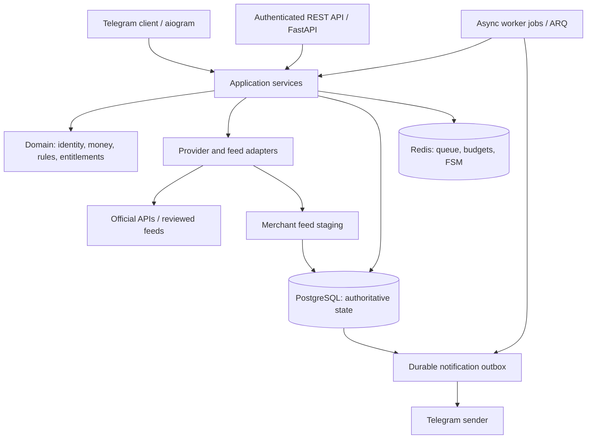

# PriceHunter

[](https://github.com/SlavaSerdyukov/price_hunter/actions/workflows/ci.yml)

**A production-oriented international price-tracking and commerce-aggregation backend**
built with Python, FastAPI, aiogram, PostgreSQL, Redis and async workers. Telegram is
one client; a versioned, bearer-authenticated REST API uses the same application services.

**Status: completed engineering portfolio project. Feature development is frozen.
No public production service is operated.** Affiliate merchant and live payment activation
were intentionally not pursued. The [case study](docs/portfolio-case-study.md) explains
the architecture, trade-offs and decision to stop product development.

**Verified baseline:** 966 automated tests, **91.57% statement coverage**, strict mypy,
Ruff and migration checks on [main `c3b1788`](https://github.com/SlavaSerdyukov/price_hunter/actions/runs/37508892290).
The stack and evidence below describe implemented engineering, not a live SaaS.

## Engineering highlights

- **Async modular monolith:** shared services and an independent domain; PostgreSQL
  owns business state, Redis provides ephemeral queues, rate budgets and FSM state.
- **Recoverable workers:** `SKIP LOCKED` claiming, database leases and fencing tokens;
  external I/O outside transactions. Observations, state and outbox events commit
  atomically. Ambiguous sends become `uncertain` instead of automatic duplicate resends.
- **Conservative identity:** deterministic product/variant canonicalization, separate
  retailer and acquisition-source identities, cross-network effective-offer selection.
- **Price correctness:** market/native-currency isolation, separate item/delivered
  winners, explicit unknown shipping/tax and commission-neutral ranking.
- **Feed and financial integrity:** generational staging/publication, catastrophic-shrink
  guards, immutable merchant audits and subscription/payment ledgers.
- **Operational verification:** exact Alembic schema preflight, real `pg_dump`/`pg_restore`,
  replay/crash acceptance and bounded authenticated HTTP load rehearsal.

## Verified quality

| Evidence | Verified result |
| --- | --- |
| Hosted main CI | **966 passed**, no skips, **91.57% statement coverage**; [baseline run](https://github.com/SlavaSerdyukov/price_hunter/actions/runs/37508892290), 2026-10-06. |
| Gates | Ruff lint/format, strict mypy, Alembic upgrade/check, historical migration preservation verifier; coverage threshold 85%. |
| Synthetic feeds | 100,000-row import/replay and validation/shrink scenarios; bounded work and traced-memory checks. |
| Local recovery | All **33 classified PostgreSQL business/schema tables** verified after real backup/restore, including identities, payloads, constraints and triggers. |
| Local HTTP rehearsal | Beta-medium: **1,400 requests**, 300 successes, 1,100 expected 429, **zero unexpected failures**, no leaked connections. |
| Manual workflow | `Synthetic recovery and load` is available; **no `workflow_dispatch` run has been performed** as of the 2026-10-31 audit. |

Synthetic timings are observations, not production capacity or RPO/RTO promises.
The existing pytest warning is upstream ARQ's deprecated Redis `close()` call.
[Snapshot audit](docs/portfolio-audit.md), [historical verification](docs/verification.md)
and [sanitized measurements](docs/m5c-rehearsal-evidence.json) distinguish hosted tests,
local rehearsals and historical live integration checks.

## Architecture



`apps` contains process entrypoints; `services` own workflows/transactions; `domain`
has no Telegram, HTTP or SQLAlchemy types. Adapters normalize source evidence into
shared DTOs. See [architecture decisions](docs/architecture.md).

## Key domain model

| Concept | Meaning |
| --- | --- |
| **Product** | Canonical purchasable item/variant, shared only when explicit identity evidence is compatible. |
| **Merchant** | Customer-visible retailer, independent of the affiliate/acquisition network. |
| **Store** | Acquisition/provider identity linked to a canonical Merchant. |
| **StoreOffer** | Source-specific listing with its own market, native currency, price and provenance. |
| **Tracker** | User's exact-listing subscription and baseline; many trackers share one refreshed offer. |
| **ProductWatch** | User's canonical-product watch in one durable market/currency, able to follow a different winning merchant. |

## Important correctness decisions

- Stale/failed offers remain labelled and visible, but cannot win the current best price.
- Native currencies and catalog markets never mix numerically in authoritative ranking;
  ECB conversion is optional reference display.
- Missing shipping/tax is **unknown**, never zero. Item price and delivered total have
  separate winners; delivery evidence is selected as one compatible source tuple.
- Explicit identifiers outrank titles; fuzzy similarity never authorizes a product merge.
- Retailer sources are linked explicitly with an audit, never automatically by name.
- Provider/network commission never affects ranking or borrows another source's link.

See [comparison](docs/comparison.md), [merchant identity](docs/merchant-identity.md)
and [delivery evidence](docs/delivery-context.md).

## Quick local demo

Requires Python 3.12+, [uv](https://docs.astral.sh/uv/getting-started/installation/)
and Docker Compose. Use a fresh checkout; keep an existing private `.env` intact.

```bash
cp .env.example .env
docker compose up -d --wait postgres redis
uv sync --frozen
uv run alembic upgrade head
uv run python -m pricehunter.apps.api
```

In separate terminals, start the worker and create an API-only account:

```bash
uv run arq pricehunter.jobs.worker.WorkerSettings
uv run python -m pricehunter.apps.admin create-api-user --label demo
```

Open [localhost:8000/docs](http://localhost:8000/docs), click **Authorize** and enter
the locally printed API key. `PATCH /api/v1/users/me/settings` with
`{"country_code":"DE"}`, then `GET /api/v1/search?q=Sony%20WH-1000XM6&country=DE`
shows deterministic multi-merchant comparisons. No retailer/payment credentials are needed.

For exact tracking, `POST /api/v1/products/resolve` with
`{"url":"https://mock.pricehunter.test/products/headphones"}`, then
`POST /api/v1/trackers` with `{"store_offer_id":"<returned id>"}`.
The worker advances its synthetic EUR price **100 → 95 → 90 → 85**, then stabilizes.
API-only accounts have no Telegram alert destination.

To try Telegram, set your own `TELEGRAM_BOT_TOKEN` locally, run
`uv run python -m pricehunter.apps.bot`, send `/start` and the same mock URL, then
choose **Track price**. Telegram is the only implemented interactive end-user client,
with seven languages; its transport needs a bot token. Automated acceptance uses a
simulated transport. Detailed [local setup/API/operations](docs/local-development.md)
and [billing lifecycle](docs/billing.md) stay outside the quick demo.

## Technology

| Area | Technologies |
| --- | --- |
| Runtime / interfaces | Python 3.12+, FastAPI, aiogram 3, Pydantic v2 |
| Persistence / jobs | SQLAlchemy 2 async, asyncpg, PostgreSQL 17, Redis 7, ARQ, Alembic |
| Integration / tooling | httpx, Decimal, Docker / Compose, uv |
| Verification | pytest / pytest-asyncio / pytest-cov, Ruff, strict mypy, GitHub Actions |

## Integration status and limitations

| Integration | Evidence and boundary |
| --- | --- |
| Mock | Default reproducible local demo and synthetic shipping quotes. |
| eBay Browse | Fixture tests plus historical Production OAuth / Belgian search, lookup and refresh verification. EPN attribution/rights are separate. |
| Public WooCommerce catalogs | Historical live API checks for PINE64 EU, RaspberryPi.dk, Hemptees and Western Shop Bruxelles; explicit data-policy review still required. |
| Amazon / Rakuten | Implemented, fixture-tested, disabled; Amazon remains API-access/tracking-approval gated. |
| Awin / TradeDoubler / CJ | Implemented feed adapters/publication safeguards; disabled, no real affiliate merchants activated. |
| Telegram Stars | Implemented recurring checkout, ledger/refunds/reconciliation; simulated lifecycle tests, no production live-payment acceptance. |

Historical retailer/Telegram checks are documented observations, **not current service
availability or ongoing commercial permissions**. The configuration example disables
real providers and billing. No public production deployment, real dynamic shipping
provider, frontend/Mini App or delivered-cost watch is part of this snapshot.
Destination-aware alerts and affiliate merchant/payment activation are intentionally
not pursued; these are scope boundaries, not an active launch backlog.

## Documentation

| Area | Entry points |
| --- | --- |
| Portfolio | [Case study](docs/portfolio-case-study.md), [snapshot audit](docs/portfolio-audit.md), [changelog/release](CHANGELOG.md) |
| Architecture / domain | [Architecture](docs/architecture.md), [comparison](docs/comparison.md), [merchant identity](docs/merchant-identity.md) |
| Commerce / comparison | [Feeds](docs/commerce-feeds.md), [feed quality](docs/feed-quality.md), [markets/policies](docs/international-commerce.md), [delivery](docs/delivery-context.md) |
| Reliability / operations | [Runtime](docs/runtime-hardening.md), [recovery](docs/disaster-recovery.md), [load](docs/load-rehearsal.md), [local demo/API](docs/local-development.md) |
| Integrations | [eBay](docs/ebay-setup.md), [public catalogs](docs/public-stores.md), [Amazon](docs/amazon-setup.md), [network guides](docs/index.md#integrations) |
| Historical design records | [Roadmap](ROADMAP.md), [verification](docs/verification.md), [complete documentation index](docs/index.md) |

No LICENSE has been selected. Licensing and any reuse grant remain the owner's decision.
